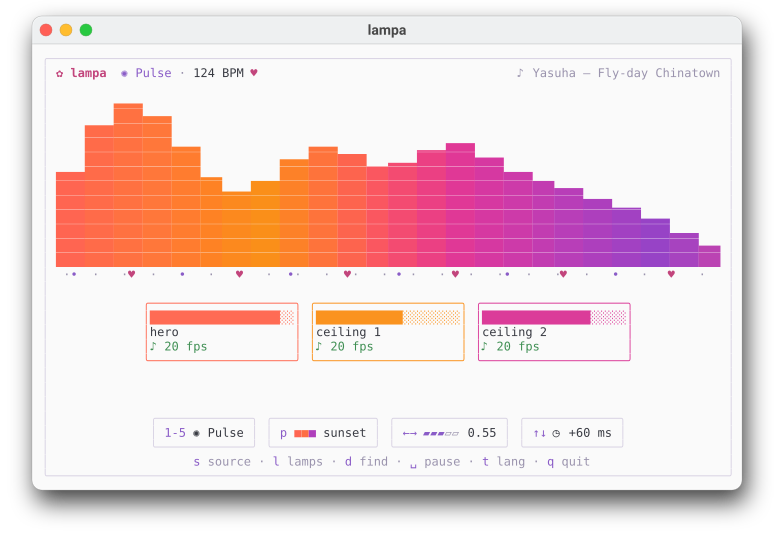

# lampa ✿

Your Mac's music → Yeelight and WiZ bulbs, in real time. A cozy terminal UI with a live spectrum, a beat ribbon and a card for every lamp.

[Русская версия](README.ru.md)

<p align="center">
  <picture>
    <source media="(prefers-color-scheme: dark)" srcset="docs/images/hero-dark.svg">
    
  </picture>
</p>

- Listens to the whole system or a single app (Core Audio process tap, no BlackHole needed)
- Finds the beat and lands flashes *on* it, with latency compensation
- Yeelight via **music mode** — no 60 commands/min limit; WiZ via local UDP
- Shows the Now Playing track (any player that appears in Control Center)
- Puts every lamp back the way it was when you quit

## Install

```bash
brew install mechanicpanic/tap/lampa
```

Builds from source (needs the Xcode Command Line Tools for Swift).

## Build

```bash
make            # bin/lampa-tap (Swift) + bin/lampa (Go)
make test
```

Needs macOS ≥ 14.4, Go and Swift. On first run macOS asks to allow audio recording for your terminal.

## Run

```bash
bin/lampa discover --save   # find lamps, save them to ~/.config/lampa/config.toml
bin/lampa                   # whole-system audio
bin/lampa --dry             # no lamps, screen only
bin/lampa --wav track.wav   # from a file
bin/lampa --lang en         # English UI (default: Russian; press t to switch)
```

Keys: `1–6` mode (Pulse, Spectrum, Chase, Ambient, Drop, Meter), `p` palette, `←/→` sensitivity, `↑/↓` light delay, `s` audio source, `l` choose lamps (on/off, remembered; `h` there hides sleeping lamps), `d` find lamps, `t` language, `space` pause, `q` quit (lamps go back to how they were).

## Lamp roles

In Spectrum mode (`2`) every lamp follows one part of the sound. Set it per lamp in `~/.config/lampa/config.toml`:

| `role` | follows |
|---|---|
| `"sub"` | sub-bass, below 60 Hz |
| `"bass"` | bass and kick, 60–250 Hz |
| `"lowmid"` | low mids, 250 Hz – 1 kHz |
| `"mid"` | mids and vocals, 1–4 kHz |
| `"high"` | hats and cymbals, above 4 kHz |

```toml
[[lamp]]
  name = "hero"
  role = "bass"

[[lamp]]
  name = "ceiling"
  role = "high"
```

Lamps without a role take bass, mid and high in turn. Other modes ignore roles: Pulse flashes every lamp on the beat, Chase walks around them.

## Stacked lamps

Bulbs that sit one above another in a single fixture can be a group. Give each the same `group` and its floor, `level = 1` at the bottom:

```toml
[[lamp]]
  name = "ikea bottom"
  group = "ikea"
  level = 1
```

Then Spectrum puts the bass at the bottom and the highs on top, Pulse flashes floor by floor from the bottom up like a fountain, Meter (`6`) fills the fixture like a volume meter, and the UI shows the group as one tall card.

## Notes

- **Yeelight:** enable "LAN Control" in the Yeelight app. lampa switches the bulb to music mode itself; if a model doesn't support it, it runs slowly and says so on its card.
- **WiZ:** some lamps (e.g. WiZ Hero) ignore broadcast discovery; lampa also asks every address on your /24 directly.
